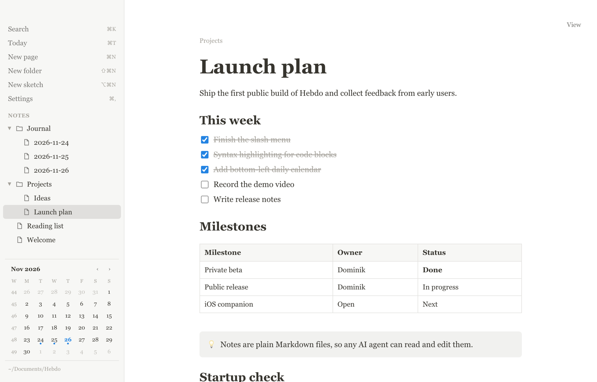
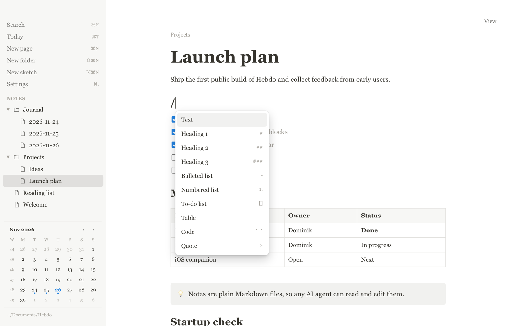
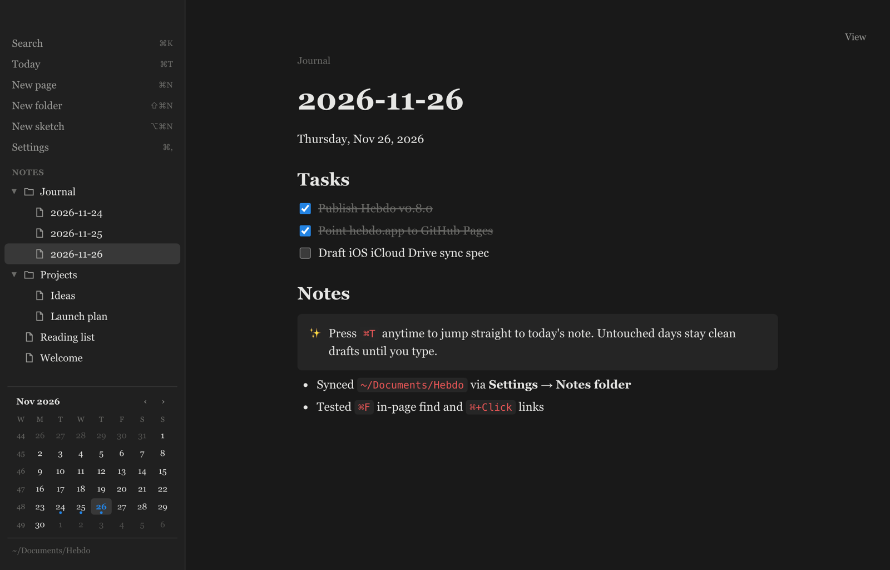

<p align="center">
  
</p>

<h1 align="center">Hebdo</h1>

<p align="center">
  A fast, open source note-taking app for macOS and iOS, built with Rust, Tauri, and SwiftUI.<br>
  Your notes are plain Markdown files synced automatically via iCloud Drive — no servers, no logins.
</p>

<p align="center">
  <a href="https://hebdo.app">hebdo.app</a> ·
  <a href="https://github.com/dominik-hurcik/hebdo/releases/latest"></a>
  
  
  <a href="LICENSE"></a>
</p>

<p align="center">
  <a href="#install">Install</a> ·
  <a href="#features">Features</a> ·
  <a href="#keyboard-shortcuts">Shortcuts</a> ·
  <a href="#use-it-with-ai-agents">AI agents</a> ·
  <a href="#build-from-source">Build from source</a>
</p>

<p align="center">
  
</p>

## Why Hebdo

Most note apps ship a full browser engine, sync servers and a database. Hebdo doesn't.

- **7 MB app.** Tauri uses the web engine already in the system, WebKit on macOS and WebView2 on Windows, so there is no bundled Chromium.
- **Rust for the app, plain JavaScript for the editor.** Rust runs the native window and all file access: saving, renaming, moving, Trash and search. The note editor is plain JavaScript and CSS with no framework. Sketches use Excalidraw, which loads only when you open one.
- **No database, no account, no network.** Every page is a `.md` file in `~/Documents/Hebdo` (or any folder you choose in Settings). Folders in the sidebar are real folders on disk.
- **Your files stay readable.** Open them in any editor, put them in Git, or sync them with iCloud Drive or Dropbox.

## Features

- Type `/` for headings, bulleted, numbered and to-do lists, tables, code blocks, quotes, callouts and dividers.
- Markdown shortcuts as you type: `# `, `- `, `1. `, `[] `, `> `, three backticks, `---`.
- Syntax highlighting for 37 languages, with automatic language detection.
- Paste formatted text from Claude, web pages and other apps. Tables, headings, lists and code keep their structure.
- Folders and pages in a sidebar. Drag to move, right-click to rename, deleted items go to the Trash or Recycle Bin.
- Built-in mini-calendar pinned to the bottom-left of the sidebar. Press ⌘T or click any day to open a daily note in `Journal/` (or switch to Weekly notes in Settings). Empty days stay in-memory drafts until you type, so browsing never creates clutter.
- Search across titles and page text with ⌘K, and find inside the open page with ⌘F.
- ⌘+Click any link to open it in your browser.
- Sketches: a whiteboard for brainstorming and presenting, powered by [Excalidraw](https://github.com/excalidraw/excalidraw). Shapes, arrows, freehand drawing, text and images, saved as `.excalidraw` files you can also open on excalidraw.com.
- Present mode with ⇧⌘F: full screen without the sidebar, for a page or a sketch.
- Export a page as PDF with ⇧⌘E, or right-click it and choose **Export as PDF**. The PDF is always in light colors.
- Drag across blocks to select several, then copy them as Markdown, cut or delete.
- A top-right View menu with full width and 100%, 90%, 80%, or 70% page zoom, remembered per note on this computer.
- Light and dark themes, custom notes folder picker, and a choice of fonts for the menus, the page and code.
- Autosave on every change, written atomically so a crash can't corrupt a note.
- Undo and redo for every change on a page, including deleted blocks, table edits and changes made by an AI agent.
- Page history. Right-click a page and choose **Page history** to restore an older version. A copy is kept every 10 minutes while you edit, in `.hebdo/history` inside your notes folder.
- Linked folders. Right-click the sidebar and choose **Link folder from disk** to show a folder from anywhere on your computer. Its pages open, save and search like your own. Hebdo adds a symlink (a junction on Windows) in your notes folder and never moves the files. **Unlink folder** removes only the link.

<table>
  <tr>
    <td></td>
    <td></td>
  </tr>
  <tr>
    <td align="center">Slash menu</td>
    <td align="center">Dark theme</td>
  </tr>
</table>

## Install

Hebdo runs on **macOS 11+** (Apple Silicon and Intel) and **iOS 17+** (native SwiftUI companion in `ios/`).

### macOS

#### Option 1: Install script (recommended)

Paste this into Terminal:

```sh
curl -fsSL https://hebdo.app/install.sh | bash
```

The script downloads the latest signed & notarized release, copies `Hebdo.app` into `/Applications` and opens it. Run the same command again to update.

#### Option 2: Download the .dmg

1. Download `Hebdo.dmg` from the [latest release](https://github.com/dominik-hurcik/hebdo/releases/latest).
2. Open it and drag Hebdo into Applications.
3. Open Hebdo — it is signed and notarized by Apple, so it opens without any Gatekeeper warning.

### iOS (iPhone & iPad)

The native SwiftUI companion app lives in [`ios/`](ios/). It syncs automatically with Hebdo for Mac over **iCloud Drive / Hebdo** — zero servers, zero logins:

```sh
cd ios && xcodegen generate && open Hebdo.xcodeproj
```

Select your iPhone in Xcode and press **⌘R**.

### Build from source

See [Build from source](#build-from-source).

## Keyboard shortcuts

On Windows, use Ctrl for ⌘, Shift for ⇧ and Alt for ⌥. For example, ⇧⌘N is Ctrl+Shift+N.

| Action | Shortcut |
| --- | --- |
| Today's note (or This week) | ⌘T |
| New page | ⌘N |
| New folder | ⇧⌘N |
| New sketch | ⌥⌘N |
| Find in page | ⌘F |
| Present (full screen) | ⇧⌘F |
| Export page as PDF | ⇧⌘E |
| Search | ⌘K |
| Settings | ⌘, |
| Toggle sidebar | ⌘\ |
| Bold, italic, inline code | ⌘B, ⌘I, ⌘E |
| Strikethrough | ⇧⌘X |
| Open link | ⌘+Click |
| Indent or outdent a list item | Tab, ⇧Tab |
| Move a block up or down | ⇧⌘↑, ⇧⌘↓ |
| Undo, redo | ⌘Z, ⇧⌘Z |
| Select all blocks | ⌘A twice |
| Leave a code block or table | Esc or ⌘Enter |

## Use it with AI agents

Hebdo has no plugin API because it doesn't need one. Point Claude Code, Codex, Cursor or any other agent at your notes folder:

```
~/Documents/Hebdo
```

The agent reads and writes `.md` files with its normal file tools. Hebdo checks the open page and the sidebar every 2 seconds, so the agent's edits show up while you watch. Right-click any page and choose **Copy path** to hand it a single file.

To keep notes somewhere else — such as an iCloud Drive or Dropbox folder — open **Settings (⌘,)** and click **Change…** next to **Notes folder**.

### File format

Sketches are Excalidraw JSON files in the `Sketches` folder. An agent can draw by adding elements to the `elements` array, and the open sketch updates within 2 seconds.

Pages are GitHub-flavored Markdown. The page title is the file name.

| Block | Markdown |
| --- | --- |
| Headings | `#`, `##`, `###` |
| Lists | `- item`, `1. item`, indented by 2 spaces per level |
| To-dos | `- [ ] open`, `- [x] done` |
| Quote | `> text` |
| Callout | `> [!NOTE]` (`TIP`, `IMPORTANT`, `WARNING`, `CAUTION`) followed by `> text` |
| Divider | `---` |
| Code | Fenced with three backticks and an optional language |
| Table | GitHub-style pipe table |
| Inline | `**bold**`, `*italic*`, `` `code` ``, `~~strike~~`, `[link](https://…)` |

## Build from source

You need [Rust](https://rustup.rs) and [Node.js](https://nodejs.org) (only for the Tauri build tool).

```sh
git clone https://github.com/dominik-hurcik/hebdo.git
cd hebdo
cargo run                                  # run in development
npx @tauri-apps/cli@2 build                # macOS: Hebdo.app and a .dmg. Windows: an installer.
cp -R target/release/bundle/macos/Hebdo.app /Applications/   # macOS only
```

An app you build yourself opens without any Gatekeeper or SmartScreen warning. On Windows the installer is in `target/release/bundle/nsis`.

### Project layout

```
src/main.rs     Rust backend: file tree, read, write, rename, move, trash, search, history
ui/app.js       Editor, sidebar, slash menu, search, settings
ui/md.js        Markdown parser and serializer
ui/style.css    Themes and layout
sketch/         Excalidraw wrapper, bundled into ui/sketch
tests/          Markdown round-trip and view tests
docs/           GitHub Pages site for hebdo.app
```

The built whiteboard bundle in `ui/sketch` is checked in, so a normal build needs no extra steps. After changing `sketch/main.jsx` or the Excalidraw version, rebuild it:

```sh
cd sketch && npm ci && npm run build
```

### Tests

```sh
cargo test
node tests/md.test.js
node tests/view.test.js
```

### Releases

Push a version tag and GitHub Actions builds universal macOS + Windows releases and publishes them:

```sh
git tag v0.7.0 && git push origin v0.7.0
```

## Contributing

Bug reports and pull requests are welcome. Hebdo aims to stay small, so open an issue to discuss a larger feature before you build it.

## License

[MIT](LICENSE)
